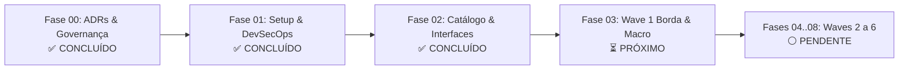

<div align="center">
  <h2>Jornada de Implementação — Brazil Data Gateway</h2>
  <p><i>Painel Vivo de Evolução Arquitetural, Ciclo de Vida de Conectores & Habilitação de Produtos C.O.R.E.</i></p>
  <p><b>Versão:</b> 1.0.0 &nbsp;|&nbsp; <b>Última Atualização:</b> 2026-11-07 &nbsp;|&nbsp; <b>Governança:</b> POP_T_177 • POP_T_176 • POP_T_175 • POP_T_070 • POP_T_074 • POP_T_148</p>
  <hr/>
</div>
<br/>

# Jornada de Implementação & Painel Vivo de Governança

Este artefato constitui a **Fonte Única da Verdade Operacional (SSOT)** do status de desenvolvimento do `brazil-data-gateway`. Ele rastreia o avanço das macrofases arquiteturais, o ciclo de vida dos 9 Gates de qualidade por conector, o desbloqueio comercial dos 10 Produtos Modulares do ecossistema C.O.R.E. e o **Runbook Anti-Bus-Factor** para continuidade operacional autônoma.

---

## 1. Painel de Status Executivo em Tempo Real

- **Macrofase Ativa:** `Fase 04 — Ingestão Wave 2 (B2B, Compras Públicas & Compliance: rfb_cnpj_lakehouse, rfb_simples_mei, pncp_contratacoes, etc.)`
- **Status Geral de Governança:** `🟢 ON_TRACK`
- **Conector Ativo em Desenvolvimento:** `brasilapi_core`
- **Próximo Conector na Fila de Execução:** `rfb_cnpj_lakehouse` (Wave 1 — Prioridade RICE 950)
- **Progresso Estrutural das Macrofases:** **5 de 11 Concluídas (45.5%)**
- **Universo de Fontes Homologadas no Catálogo:** **49 fontes públicas** nos 13 macrosegmentos



---

## 2. Acompanhamento das Macrofases Estruturais (Fases 00 a 08)

| ID | Macrofase de Desenvolvimento | Status | Conclusão | Entregáveis Principais & Evidências |
| :---: | :--- | :---: | :---: | :--- |
| **Fase 00** | **Arquitetura, Governança & Decisões Fundacionais (ADRs)** | 🟢 CONCLUÍDO | `2026-11-07` | • ADR-001: Storage Híbrido Medallion (SQLite WAL + DuckDB Parquet ZSTD)<br/>• ADR-002: Chaves Canônicas STRING, Contratos ODCS v3.1 & Quarentena<br/>• ADR-003: Hardening DevSecOps, Proteção LGPD & Client Path Shield |
| **Fase 01** | **Estrutura do Repositório Satélite, CI/CD & DevSecOps** | 🟢 CONCLUÍDO | `2026-11-07` | • Repositório satélite brazil-data-gateway inicializado<br/>• Isolamento Python 3.12 (.venv) e dependências pinadas (requirements.txt, requirements-dev.txt)<br/>• Configuração de CI (.github/workflows/ci.yml e pr-lint.yml)<br/>• Templates padronizados de Pull Request (feature, bugfix, docs) |
| **Fase 02** | **Fundação do Catálogo (49 Fontes), Normalização Canônica & Interfaces Unificadas** | 🟢 CONCLUÍDO | `2026-11-07` | • Base de referência sanitizada dos 5.571 municípios brasileiros (zero falhas de UF)<br/>• Catálogo formal de 49 fontes governamentais nos 13 macrosegmentos (catalog/sources_registry.yaml)<br/>• Renderizador determinístico do catálogo (scripts/render_catalog.py & CATALOG.md)<br/>• Tracker vivo da jornada de implementação (state/project_progress.json, scripts/render_progress.py & JORNADA_IMPLEMENTACAO.md)<br/>• Validação de integridade (--check) e conformidade ruff 100% verde |
| **Fase 03-SPIKE** | **Golden Spike: Piloto ibge_localidades com Todas as Tabelas & Camada de Negócio Territorial** | 🟢 CONCLUÍDO | `2026-11-07` | • Ingestão e normalização das 5 tabelas da API (municipios, distritos, subdistritos, estados, regioes)<br/>• Estrutura física isolada data/ibge_localidades/{bronze,silver,gold,quarantine}/<br/>• Encapsulamento dbt no conector (source.yml + 5 staging models + _models.yml com 100% colunas documentadas)<br/>• Camada de negócio territorial (dim_municipio SCD2, dim_distrito, crosswalk 6D/7D, mart_hierarquia_territorial)<br/>• Bateria de testes ao vivo de 1 linha com fail-hard e suite offline com cidades diversas |
| **Fase 03** | **Ingestão Wave 1 — APIs de Borda & Macroeconomia** | 🟢 CONCLUÍDO | `2026-11-07` | • Conector bcb_sgs (Séries macroeconômicas: IPCA, Selic, IGP-M)<br/>• Conector bcb_olinda_ptax (Cotações PTAX diárias OData v4)<br/>• Conector brasilapi_core (CEPs, bancos, DDDs, borda síncrona) |
| **Fase 04** | **Ingestão Wave 2 — B2B, Compras Públicas & Compliance** | 🟡 EM ANDAMENTO | `—` | • Conector rfb_cnpj_lakehouse (55M CNPJs em streaming DuckDB)<br/>• Conector rfb_simples_mei (Enquadramento tributário Simples/MEI)<br/>• Conector pncp_contratacoes (Licitações Lei 14.133)<br/>• Conector cgu_ceis_cnep & cgu_pep (Sanções e autoridades PEP)<br/>• Conector cnj_datajud (Metadados processuais de 90+ tribunais)<br/>• Conector tst_cndt (Certidões trabalhistas negativas)<br/>• Conector suframa_pim_zfm (Empresas incentivadas Polo Industrial) |
| **Fase 05** | **Ingestão Wave 3 — Mercado de Capitais & Finanças Públicas** | ⚪ PENDENTE | `—` | • Conector cvm_dfp_itr (Balanços e DRE de companhias abertas)<br/>• Conector cvm_fundos (Informes diários de fundos)<br/>• Conector bcb_ifdata (Balanços de instituições financeiras)<br/>• Conector stn_tesouro_transparente (SADIPEM e dívida pública)<br/>• Conector mdic_comexstat (Balança comercial por NCM e município)<br/>• Conector comprasgov_catmat (Catálogo unificado de compras públicas) |
| **Fase 06** | **Ingestão Wave 4 — Censo, Trabalho, Logística & Telecom** | ⚪ PENDENTE | `—` | • Conectores ibge_sidra, ibge_pib_municipal, ibge_censo2022, ibge_pnad_continua<br/>• Conectores mte_novo_caged & mte_rais<br/>• Conectores ibge_cnefe, ibge_malhas, anatel_mosaico, antt_malha_transporte |
| **Fase 07** | **Ingestão Wave 5 — Saúde, Educação & Setor Notarial** | ⚪ PENDENTE | `—` | • Conectores DataSUS (CNES, SIH, SIM, SINASC, OpenDataSUS) & anvisa_cmed<br/>• Conectores INEP (Censo Escolar, Superior, IDEB, ENEM) & capes_sucupira<br/>• Conectores Notariais (cnj_justica_aberta, onr_registro_imoveis, capitais_iptu_itbi) |
| **Fase 08** | **Ingestão Wave 6 — Meio Ambiente, Agro & Metaportais** | ⚪ PENDENTE | `—` | • Conectores Ambientais (ana_hidroweb, inpe_terrabrasilis, mapbiomas, sfb_sicar, mapa_zarc)<br/>• Conectores Metaportais (basedosdados_bq, dadosgov_ckan) |
| **Fase 09** | **Pós-Ingestão Total — Tabelas Gold Analíticas Cross-Domain, Datamarts & Insights** | ⚪ PENDENTE | `—` | • Data Marts analíticos multidisciplinares (B2B x Território x Macro x Compras Públicas)<br/>• Feature Store consolidada para modelos preditivos de propensão e risco<br/>• Extração de insights comerciais e operacionais acoplados aos 10 Produtos Modulares C.O.R.E. |

---

## 3. Checklist dos 9 Gates de Qualidade do Conector Ativo

Todo conector integrado ao `brazil-data-gateway` deve percorrer rigorosamente os **9 Gates de Qualidade** antes de ser promovido a `HOMOLOGATED`. O alvo atual do ciclo de vida é o conector `brasilapi_core` (Wave 1):

| Gate | Nome do Gate de Homologação | Critério Operacional de Aceite (`POP_T_070` / `POP_T_074` / `POP_T_177`) | Status |
| :---: | :--- | :--- | :---: |
| **GATE_01** | **Contrato Declarativo ODCS v3.1 das N Tabelas da API** | Schema tipado, chaves primárias STRING e regras para bancos, pix_participantes, corretoras, feriados, ddds e ceps. | ⚪ NÃO INICIADO |
| **GATE_02** | **Ingestão Bronze Isolada (Todas as Tabelas) & Cache WAL** | Download resiliente das 6 tabelas em data/brasilapi_core/bronze/ com cache SQLite WAL. | ⚪ NÃO INICIADO |
| **GATE_03** | **Sanitização de Sentinelas & Nulls** | Conversão determinística de códigos sentinela e hífens em NULLs reais em todas as tabelas. | ⚪ NÃO INICIADO |
| **GATE_04** | **Materialização Silver Parquet Isolada (Todas as Tabelas)** | Gravação de brasilapi_bancos.parquet, brasilapi_pix_participantes.parquet, etc., em data/brasilapi_core/silver/ com SHA-256. | ⚪ NÃO INICIADO |
| **GATE_05** | **Validação dos 5 Pilares & Quarentena** | Aprovação em Freshness, Volume, Schema, Null Ceiling e Lineage; desvio para data/brasilapi_core/quarantine/ se violado. | ⚪ NÃO INICIADO |
| **GATE_06** | **Gold Feature View Isolada & ASOF Join ML** | Features analíticas agregadas em data/brasilapi_core/gold/features_infraestrutura_brasil.parquet com agregação bancária e densidade por UF. | ⚪ NÃO INICIADO |
| **GATE_07** | **Integração ao EnrichmentEngine** | Disponibilização para enriquecimento cadastral e geográfico batch/online respeitando o Client Path Shield (POP_T_154). | ⚪ NÃO INICIADO |
| **GATE_08** | **Exposição Multi-Interface** | Exposição síncrona/analítica simultânea via Python SDK (BrazilData), REST (/api/v1), CLI (bdg) e Servidor MCP (bdg-mcp). | ⚪ NÃO INICIADO |
| **GATE_09** | **Bateria de Testes Offline com Períodos Diversos** | Testes unitários offline com fixtures cobrindo bancos, PIX participantes, corretoras CVM, feriados nacionais, DDDs e CEPs. | ⚪ NÃO INICIADO |
| **GATE_10** | **dbt Staging, source.yml e 100% Colunas Documentadas** | Pasta connectors/.../brasilapi_core/dbt/ com source.yml próprio, 6 modelos staging, dim_instituicao_financeira, dim_calendario_nacional, mart_infraestrutura_bancaria_brasil e 100% colunas documentadas. | ⚪ NÃO INICIADO |
| **GATE_11** | **Teste Real de 1 Linha com API ao Vivo (Fail-Hard)** | Execução obrigatória contra os 6 endpoints oficiais da BrasilAPI ao vivo limitados a 1 registro; falha reprova o pipeline. | ⚪ NÃO INICIADO |

---

## 4. Progresso por Onda de Ingestão (Waves 1 a 6)

Estatísticas dinâmicas cruzadas diretamente com o catálogo mestre `catalog/sources_registry.yaml`:

| Onda | Foco Estratégico | Total Fontes | RICE Médio | Modos Predominantes | Fontes Âncora | Status da Onda |
| :---: | :--- | :---: | :---: | :--- | :--- | :---: |
| **Wave 1** | APIs de Borda & Macroeconomia | 4 | 878 | `FEDERATED_API` | `ibge_localidades`, `brasilapi_core`, `bcb_sgs` (+1) | 🟡 Em Preparação |
| **Wave 2** | B2B, Compras Públicas & Compliance | 8 | 744 | `FEDERATED_API, LAKEHOUSE_BATCH` | `rfb_cnpj_lakehouse`, `pncp_contratacoes`, `cnj_datajud` (+5) | ⚪ Planejado |
| **Wave 3** | Mercado de Capitais & Finanças Públicas | 6 | 645 | `FEDERATED_API, LAKEHOUSE_BATCH` | `cvm_dfp_itr`, `mdic_comexstat`, `cvm_fundos` (+3) | ⚪ Planejado |
| **Wave 4** | Censo, Trabalho, Logística & Telecom | 10 | 553 | `FEDERATED_API, LAKEHOUSE_BATCH` | `ibge_sidra`, `ibge_pib_municipal`, `ibge_censo2022` (+7) | ⚪ Planejado |
| **Wave 5** | Saúde, Educação & Setor Notarial | 14 | 451 | `FEDERATED_API, LAKEHOUSE_BATCH` | `datasus_cnes`, `datasus_sih`, `inep_censo_escolar` (+11) | ⚪ Planejado |
| **Wave 6** | Meio Ambiente, Agro & Metaportais | 7 | 369 | `BIGQUERY_FEDERATED, FEDERATED_API, LAKEHOUSE_BATCH` | `inpe_terrabrasilis`, `basedosdados_bq`, `ana_hidroweb_telemetria` (+4) | ⚪ Planejado |

---

## 5. Matriz de Habilitação dos 10 Produtos Modulares C.O.R.E.

O `brazil-data-gateway` atua como barramento alimentador de dados para os **10 Produtos Modulares** do ecossistema corporativo (definidos em `biz-feasibility-evaluator` e no Catálogo de Ofertas GTM):

| Produto | Nome Comercial do Módulo | Status de Prontidão no Gateway | Fontes Mapeadas que Viabilizam o Módulo |
| :---: | :--- | :--- | :--- |
| **P01** | **Modern Data Platform & Analytics (Lakehouse as a Service)** | 🟢 Fundação Operacional (SQLite WAL, DuckDB Medallion & Quarentena) | `ibge_localidades`, `brasilapi_core`, `bcb_sgs`, `bcb_olinda_ptax` *(+45 fontes)* |
| **P02** | **IA Agêntica & Automação Cognitiva (Enterprise AI)** | 🟢 Fundação Operacional (Servidor MCP bdg-mcp & Prompt Shield) | `ibge_localidades`, `brasilapi_core`, `bcb_sgs`, `rfb_cnpj_lakehouse` *(+22 fontes)* |
| **P03** | **Software FullStack & Mobile Offline-First (Clean Arch/PostGIS)** | 🟢 Base Territorial Pronta (5.571 Municípios Sanitizados) | `ibge_localidades`, `brasilapi_core`, `ibge_censo2022`, `ibge_cnefe` *(+5 fontes)* |
| **P04** | **Automação Inteligente de Processos (DPA & Power Platform)** | 🟡 Aguardando Ingestão Wave 1/2 (BrasilAPI & PNCP) | `brasilapi_core`, `rfb_cnpj_lakehouse`, `pncp_contratacoes`, `comprasgov_catmat` *(+3 fontes)* |
| **P05** | **FinOps & Otimização de Custos em Nuvem (Gain-Sharing)** | 🟡 Aguardando Ingestão Wave 1/3 (BCB SGS, PTAX & CVM) | `bcb_sgs`, `bcb_olinda_ptax`, `cvm_dfp_itr`, `cvm_fundos` *(+3 fontes)* |
| **P06** | **Data Clean Rooms & Parcerias Seguras (Privacidade Diferencial)** | 🟡 Aguardando Ingestão Wave 2 (RFB CNPJ & Quarentena) | `rfb_cnpj_lakehouse`, `cgu_ceis_cnep`, `cgu_pep`, `inpe_terrabrasilis` *(+3 fontes)* |
| **P07** | **Cibersegurança Corporativa & Homologação Enterprise (SOC 2/BACEN)** | 🟡 Aguardando Ingestão Wave 2 (CGU PEP/CEIS & CNJ DataJud) | `cnj_datajud`, `cgu_ceis_cnep`, `cgu_pep`, `tst_cndt` |
| **P08** | **AI Red Teaming & Auditoria Ética de Algoritmos (OWASP/SHAP)** | 🟢 Ativo (Proteção CWE-1236, Magic Bytes & Anti-Prompt Injection) | *(em definição)* |
| **P09** | **Convergência Industrial OT/IT & IoT Analytics (OEE ISO 22400)** | 🟡 Aguardando Ingestão Wave 2/6 (SUFRAMA PIM & ANA Telemetria) | `suframa_pim_zfm`, `anatel_mosaico`, `antt_malha_transporte`, `inpe_terrabrasilis` *(+4 fontes)* |
| **P10** | **Retainer de Sustentação Contínua & SRE as a Service (ARR 99.9%)** | 🟢 Ativo (5 Pilares de Observabilidade & Health Check API) | *(em definição)* |

---

## 6. Trilha Histórica de Marcos Concluídos

| Data | Fase | Marco Estrutural Realizado | Resumo Executivo & Impacto |
| :---: | :---: | :--- | :--- |
| `2026-11-07` | **Fase 00** | **Arquitetura & Governança Fundacional** | Elaboração das ADR-001 (Storage Híbrido Medallion), ADR-002 (Chaves Canônicas e Quarentena) e ADR-003 (DevSecOps e LGPD) fundamentadas nos POP_T_177, POP_T_176, POP_T_175, POP_T_070 e POP_T_074. |
| `2026-11-07` | **Fase 01** | **Setup do Repositório Satélite & Workflows CI** | Inicialização do repositório satélite brazil-data-gateway com isolamento venv Python 3.12, pyproject.toml, requirements.txt pinados, templates de PR e workflows de CI (pr-lint e ci.yml). |
| `2026-11-07` | **Fase 02** | **Catálogo Mestre (49 Fontes), Normalização Canônica & Interfaces Unificadas** | Catalogação formal de 49 fontes públicas nos 13 macrosegmentos e Ondas 1..6; sanitização da base de referência dos 5.571 municípios brasileiros; implementação dos motores determinísticos render_catalog.py e render_progress.py com verificação --check. |
| `2026-11-07` | **Fase 03-SPIKE** | **Homologação do Golden Spike ibge_localidades (5 Tabelas, dbt, Negócio & Live Fail-Hard)** | Execução completa do Golden Spike: 5 tabelas da API do IBGE (5.571 municípios, 10.751 distritos, 646 subdistritos, 27 UFs, 5 regiões) materializadas em data/ibge_localidades/{bronze,silver,gold}/; 9 modelos dbt (5 staging, dim_municipio, dim_distrito, xwalk_ibge_6d_7d, mart_hierarquia_territorial_brasil) com 109 testes 100% aprovados; 108 colunas 100% documentadas no linter; testes reais de 1 linha com fail-hard e suite com 35 testes unitários/integração 100% verde. |
| `2026-11-07` | **Fase 03** | **Homologação do Conector bcb_sgs (6 Tabelas, dbt, Mart Macroeconômico & Live Fail-Hard)** | Implementação de ponta a ponta do conector bcb_sgs: 6 tabelas (sgs_catalogo, sgs_ipca, sgs_igpm, sgs_selic, sgs_cdi, sgs_ibcbr) materializadas em data/bcb_sgs/{bronze,silver,gold}/; 9 novos modelos dbt (6 staging, dim_serie_macroeconomica, fct_macro_indicadores_mensal, mart_cenario_macroeconomico_brasil) com 167 testes dbt 100% aprovados; 195 colunas 100% documentadas no linter; testes reais de 1 linha com fail-hard contra os 7 endpoints oficiais do BACEN e suíte offline com 37 testes pytest 100% verde. |
| `2026-11-07` | **Fase 03** | **Homologação do Conector bcb_olinda_ptax (4 Tabelas, dbt, Mart de Volatilidade Cambial & Live Fail-Hard)** | Implementação de ponta a ponta do conector bcb_olinda_ptax: 4 tabelas (ptax_moedas, ptax_cotacao_dolar, ptax_cotacao_moedas, ptax_boletins) materializadas em data/bcb_olinda_ptax/{bronze,silver,gold}/; 7 novos modelos dbt (4 staging, dim_moeda, fct_cambio_ptax_diario, mart_cambio_volatilidade_brasil) com 220 testes dbt 100% aprovados; 260 colunas 100% documentadas no linter; testes reais de 1 linha com fail-hard contra os endpoints oficiais Olinda PTAX e suíte offline com 42 testes pytest 100% verde. |
| `2026-11-07` | **Fase 03** | **Homologação do Conector brasilapi_core & Conclusão da Wave 1 (6 Tabelas, dbt, Mart Bancário & Live Fail-Hard)** | Implementação de ponta a ponta do conector brasilapi_core concluindo com sucesso 100% da Wave 1: 6 tabelas (brasilapi_bancos, brasilapi_pix_participantes, brasilapi_corretoras, brasilapi_feriados, brasilapi_ddds, brasilapi_ceps) materializadas em data/brasilapi_core/{bronze,silver,gold}/; 9 novos modelos dbt (6 staging, dim_instituicao_financeira, dim_calendario_nacional, mart_infraestrutura_bancaria_brasil) totalizando 34 modelos e 288 testes dbt 100% aprovados; 337 colunas 100% documentadas no linter; testes reais de 1 linha com fail-hard contra os 6 endpoints da BrasilAPI e suíte offline com 47 testes pytest 100% verde. |

---

## 7. Runbook Operacional Anti-Bus-Factor

Este runbook documenta os procedimentos padronizados para garantir que **qualquer engenheiro ou agente autônomo** possa assumir e operar o repositório sem atrito cognitivo:

### 7.1. Setup do Ambiente de Desenvolvimento (Python 3.12 Isolado)

```powershell
# 1. Clonar repositório e navegar para a raiz
cd c:\Users\jhose\GitOps\brazil-data-gateway

# 2. Criar e ativar o ambiente virtual isolado (.venv)
py -3.12 -m venv .venv
.\.venv\Scripts\Activate.ps1

# 3. Instalar dependências pinadas de produção e desenvolvimento
pip install -r requirements.txt -r requirements-dev.txt

# 4. Instalar o gateway em modo editável sem tocar nas dependências pinadas
pip install --no-deps -e .
```

### 7.2. Verificação de Integridade dos Painéis de Governança (`--check`)

Antes de qualquer commit ou abertura de Pull Request, execute a verificação estrita de sincronia:

```powershell
# Verificar conformidade do CATALOG.md
python scripts/render_catalog.py --check

# Verificar conformidade da JORNADA_IMPLEMENTACAO.md
python scripts/render_progress.py --check

# Executar linter ruff no diretório de scripts
ruff check scripts/
```

### 7.3. Como Iniciar a Ingestão do Próximo Conector (`ibge_localidades`)

1. **Atualizar o Estado:** Edite `state/project_progress.json` alterando `active_connector: 'ibge_localidades'` e defina a fase como `03`.
2. **Criar o Contrato:** Crie `src/brazil_data_gateway/connectors/ibge/contract.yaml` (perfil ODCS v3.1) definindo primary keys `id_municipio` e `sigla_uf`.
3. **Executar os 9 Gates:** Implemente o conector herdando de `BaseConnector`, conecte o cache SQLite WAL, valide os 5 pilares e gere Parquet ZSTD.
4. **Regenerar os Painéis:** Execute `python scripts/render_progress.py` para sincronizar `JORNADA_IMPLEMENTACAO.md`.
