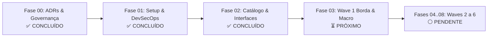

<div align="center">
  <h2>Jornada de Implementação — Brazil Data Gateway</h2>
  <p><i>Painel Vivo de Evolução Arquitetural, Ciclo de Vida de Conectores & Habilitação de Produtos C.O.R.E.</i></p>
  <p><b>Versão:</b> 1.0.0 &nbsp;|&nbsp; <b>Última Atualização:</b> 2026-11-13T23:18:00.000000 &nbsp;|&nbsp; <b>Governança:</b> POP_T_177 • POP_T_176 • POP_T_175 • POP_T_070 • POP_T_074 • POP_T_148</p>
  <hr/>
</div>
<br/>

# Jornada de Implementação & Painel Vivo de Governança

Este artefato constitui a **Fonte Única da Verdade Operacional (SSOT)** do status de desenvolvimento do `public-data-gateway`. Ele rastreia o avanço das macrofases arquiteturais, o ciclo de vida dos 9 Gates de qualidade por conector, o desbloqueio comercial dos 10 Produtos Modulares do ecossistema C.O.R.E. e o **Runbook Anti-Bus-Factor** para continuidade operacional autônoma.

---

## 1. Painel de Status Executivo em Tempo Real

- **Macrofase Ativa:** `Fase 07 - Ingestão Wave 5 (Saúde, Educação & Setor Notarial — 36/49 fontes homologadas [73.5%] com anvisa_cmed homologado; Próximo: inep_ideb)`
- **Status Geral de Governança:** `🟢 ON_TRACK`
- **Conector Ativo em Desenvolvimento:** `inep_ideb`
- **Próximo Conector na Fila de Execução:** `onr_registro_imoveis` (Wave 1 — Prioridade RICE 950)
- **Progresso Estrutural das Macrofases:** **8 de 13 Concluídas (61.5%)**
- **Universo de Fontes Homologadas no Catálogo:** **49 fontes públicas** nos 13 macrosegmentos



---

## 2. Acompanhamento das Macrofases Estruturais (Fases 00 a 08)

| ID | Macrofase de Desenvolvimento | Status | Conclusão | Entregáveis Principais & Evidências |
| :---: | :--- | :---: | :---: | :--- |
| **Fase 00** | **Arquitetura, Governança & Decisões Fundacionais (ADRs)** | 🟢 CONCLUÍDO | `2026-11-07` | • ADR-001: Storage Híbrido Medallion (SQLite WAL + DuckDB Parquet ZSTD)<br/>• ADR-002: Chaves Canônicas STRING, Contratos ODCS v3.1 & Quarentena<br/>• ADR-003: Hardening DevSecOps, Proteção LGPD & Client Path Shield |
| **Fase 01** | **Estrutura do Repositório Satélite, CI/CD & DevSecOps** | 🟢 CONCLUÍDO | `2026-11-07` | • Repositório satélite brazil-data-gateway inicializado<br/>• Isolamento Python 3.12 (.venv) e dependências pinadas (requirements.txt, requirements-dev.txt)<br/>• Configuração de CI (.github/workflows/ci.yml e pr-lint.yml)<br/>• Templates padronizados de Pull Request (feature, bugfix, docs) |
| **Fase 02** | **Fundação do Catálogo (49 Fontes), Normalização Canônica & Interfaces Unificadas** | 🟢 CONCLUÍDO | `2026-11-07` | • Base de referência sanitizada dos 5.571 municípios brasileiros (zero falhas de UF)<br/>• Catálogo formal de 49 fontes governamentais nos 13 macrosegmentos (catalog/sources_registry.yaml)<br/>• Renderizador determinístico do catálogo (scripts/render_catalog.py & CATALOG.md)<br/>• Tracker vivo da jornada de implementação (state/project_progress.json, scripts/render_progress.py & JORNADA_IMPLEMENTACAO.md)<br/>• Validação de integridade (--check) e conformidade ruff 100% verde |
| **Fase 03-SPIKE** | **Golden Spike: Piloto ibge_localidades com Todas as Tabelas & Camada de Negócio Territorial** | 🟢 CONCLUÍDO | `2026-11-07` | • Ingestão e normalização das 5 tabelas da API (municipios, distritos, subdistritos, estados, regioes)<br/>• Estrutura física isolada data/ibge_localidades/{bronze,silver,gold,quarantine}/<br/>• Encapsulamento dbt no conector (source.yml + 5 staging models + _models.yml com 100% colunas documentadas)<br/>• Camada de negócio territorial (dim_municipio SCD2, dim_distrito, crosswalk 6D/7D, mart_hierarquia_territorial)<br/>• Bateria de testes ao vivo de 1 linha com fail-hard e suite offline com cidades diversas |
| **Fase 03** | **Ingestão Wave 1 — APIs de Borda & Macroeconomia** | 🟢 CONCLUÍDO | `2026-11-07` | • Conector bcb_sgs (Séries macroeconômicas: IPCA, Selic, IGP-M)<br/>• Conector bcb_olinda_ptax (Cotações PTAX diárias OData v4)<br/>• Conector brasilapi_core (CEPs, bancos, DDDs, borda síncrona) |
| **Fase 04** | **Ingestão Wave 2 — B2B, Compras Públicas & Compliance** | 🟢 CONCLUÍDO | `2026-11-08` | • Conector rfb_cnpj_lakehouse (55M CNPJs em streaming DuckDB)<br/>• Conector rfb_simples_mei (Enquadramento tributário Simples/MEI)<br/>• Conector pncp_contratacoes (Licitações Lei 14.133)<br/>• Conector cgu_ceis_cnep & cgu_pep (Sanções e autoridades PEP)<br/>• Conector cnj_datajud (Metadados processuais de 90+ tribunais)<br/>• Conector tst_cndt (Certidões trabalhistas negativas)<br/>• Conector suframa_pim_zfm (Empresas incentivadas Polo Industrial) |
| **Fase 05** | **Ingestão Wave 3 — Mercado de Capitais & Finanças Públicas** | 🟢 CONCLUÍDO | `2026-11-08` | • Conector cvm_dfp_itr (Balanços e DRE de companhias abertas)<br/>• Conector cvm_fundos (Informes diários de fundos)<br/>• Conector bcb_ifdata (Balanços de instituições financeiras)<br/>• Conector stn_tesouro_transparente (SADIPEM e dívida pública)<br/>• Conector mdic_comexstat (Balança comercial por NCM e município)<br/>• Conector comprasgov_catmat (Catálogo unificado de compras públicas) |
| **Fase 06** | **Ingestão Wave 4 — Censo, Trabalho, Logística & Telecom** | 🟢 CONCLUÍDO | `2026-11-13` | • Conector ibge_sidra (PIB municipal, Censo demográfico, PAM, IPCA e Gini) - CONCLUÍDO<br/>• Conector ibge_censo2022 (Microdados, Domicílios, Estrutura Etária, Alfabetização, Diversidade) - CONCLUÍDO<br/>• Conector mte_novo_caged (Microdados do Novo CAGED, Movimentação Mensal, Perfil Setorial, Salários) - CONCLUÍDO<br/>• Conector ibge_pnad_continua (Taxa de Desocupação, Rendimento Médio Real, Subutilização, Informalidade) - CONCLUÍDO<br/>• Conector ibge_pib_municipal (PIB Municipal, VAB Setorial, Contas Econômicas) - CONCLUÍDO<br/>• Conector mte_rais (Relação Anual de Informações Sociais - Vínculos & Remuneração) - CONCLUÍDO<br/>• Conector ibge_malhas (Malhas Territoriais Vetoriais - Municípios, UFs, Regiões) - CONCLUÍDO<br/>• Conector ibge_cnefe (Endereçamento Estatístico CNEFE - Censo 2022) - CONCLUÍDO<br/>• Conector anatel_mosaico (Sistema Mosaico ERBs, Banda Larga SCM, Espectro & 5G) - CONCLUÍDO<br/>• Conector antt_malha_transporte (Malha Rodoviária, RNTRC, Ferroviária e Matriz Modal) - CONCLUÍDO |
| **Fase 07** | **Ingestão Wave 5 — Saúde, Educação & Setor Notarial** | 🟡 EM ANDAMENTO | `—` | • Conector datasus_cnes (Estabelecimentos, Leitos/UTI, Equipamentos Diagnósticos e Força de Trabalho) - CONCLUÍDO<br/>• Conector datasus_sih (Produção Hospitalar AIH, Custos SUS/UTI, Morbidade CID-10 e Desfechos/ICSAP) - CONCLUÍDO<br/>• Conector inep_censo_escolar (Escolas/Infraestrutura, Matrículas por Etapa, Docentes/AFD e Rendimento/Fluxo) - CONCLUÍDO<br/>• Conector datasus_sim (Óbitos Gerais/DO, Causas Capítulos CID-10, Mortalidade Materno-Infantil e Prematura DCNT/Causas Externas) - CONCLUÍDO<br/>• Conector inep_censo_superior (Instituições IES/IGC, Cursos CINE/ENADE, Matrículas/TCG/TDA e Corpo Docente) - CONCLUÍDO<br/>• Conector cnj_justica_aberta (Serventias Extrajudiciais, Produtividade por Atribuição, Emolumentos e Digitalização SREI/ONR/CRC) - CONCLUÍDO<br/>• Conector datasus_sinasc (Nascidos Vivos, Assistência Pré-Natal e Parto, Perfil Materno Demográfico e Vitalidade Recém-Nascido) - CONCLUÍDO<br/>• Conector anvisa_cmed (Apresentações Ativas CMED, Preços PF/PMC/PMVG por Classe Terapêutica ATC, CAP/SUS e Regime ICMS/PIS-COFINS) - CONCLUÍDO<br/>• Conector DataSUS restante (opendatasus_vigilancia)<br/>• Conectores INEP restantes (IDEB, ENEM) & capes_sucupira<br/>• Conectores Notariais restantes (onr_registro_imoveis, capitais_iptu_itbi) |
| **Fase 08** | **Ingestão Wave 6 — Meio Ambiente, Agro & Metaportais** | ⚪ PENDENTE | `—` | • Conectores Ambientais (ana_hidroweb, inpe_terrabrasilis, mapbiomas, sfb_sicar, mapa_zarc)<br/>• Conectores Metaportais (basedosdados_bq, dadosgov_ckan) |
| **Fase 09** | **Pós-Ingestão Total — Tabelas Gold Analíticas Cross-Domain, Datamarts & Insights** | ⚪ PENDENTE | `—` | • Data Marts analíticos multidisciplinares (B2B x Território x Macro x Compras Públicas)<br/>• Feature Store consolidada para modelos preditivos de propensão e risco<br/>• Extração de insights comerciais e operacionais acoplados aos 10 Produtos Modulares C.O.R.E.<br/>• Bateria de Regressão Live Global com Rotação Sistemática de IDs: Re-execução obrigatória de testes reais ao vivo contra todos os órgãos públicos, alternando e rotacionando os IDs de consulta (novos CNPJs, novos municípios IBGE, novas moedas, séries BACEN e novos contratos PNCP) para validar a resiliência contínua contra drift em produção sem overfitting a registros pontuais |
| **Fase 10** | **Expansão de Fronteira: Auditoria Conecta GOV.BR, Google APIs & Inclusão de APIs Públicas Globais e Geoespaciais** | ⚪ PENDENTE | `—` | • Auditoria e varredura do Conecta GOV.BR (https://www.gov.br/conecta/catalogo/) para identificar e homologar APIs governamentais federais adicionais que ficaram fora do catálogo inicial<br/>• Mapeamento, seleção e pré-configuração de APIs públicas globais e geoespaciais de alto valor analítico: Google APIs (Google Maps Geocoding, Places, Routes) e alternativas abertas como OpenStreetMap / Nominatim (https://www.openstreetmap.org/) e Mapbox API (https://www.mapbox.com/)<br/>• Ampliação do escopo do gateway para além das APIs governamentais do Brasil: mapeamento sistemático e suporte a outras APIs públicas úteis (ex.: dados climáticos, câmbio internacional, georreferenciamento global), deixando os conectores pré-configurados<br/>• Bipartição da documentação oficial, dbt e catálogo mestre estruturada em: 1) Catálogo APIs Gov Brasil e 2) Catálogo Outras APIs Públicas & Globais<br/>• Disponibilização de conectores com o mesmo padrão ODCS v3.1, camadas Medallion (Bronze/Silver/Gold) e testes fail-hard com limites de rate limit e FinOps |
| **Fase 11** | **Cloud Lakehouse Mirror: Public Data Warehouse na Nuvem (S3 / Cloudflare R2 + DuckDB / MotherDuck / BigQuery)** | ⚪ PENDENTE | `—` | • Arquitetura de Lakehouse na Nuvem: Espelhamento contínuo dos datasets Silver e Gold (Parquet ZSTD) para Object Storage global (AWS S3 ou Cloudflare R2 com custo zero de egress)<br/>• Pipeline de Ingestão em Lote e CDC (Change Data Capture): Rotinas agendadas (Cron/Airflow/GitHub Actions) para baixar dumps massivos (ex: 55M CNPJs RFB, CVM DFP/ITR anual) e sincronizar deltas incrementais sem depender de chamadas pontuais às APIs governamentais<br/>• Public Data Warehouse Serverless: Disponibilização de catálogo DuckDB / MotherDuck / BigQuery permitindo consultas analíticas em milissegundos sobre todo o patrimônio de dados públicos do Brasil<br/>• Estratégia FinOps e Resiliência contra Quedas de Portais: Eliminação de latências e instabilidades governamentais (Serpro, CVM, BCB), reduzindo o tempo de consulta de 2-5s para 5-15ms e economizando custos de infraestrutura<br/>• Mapeamento e Auditoria de Freshness SLA por Fonte: Avaliar e cadastrar para cada uma das 49 fontes os metadados de frequência e latência de atualização (update_frequency, freshness_sla_hours e cron_schedule_expression) para orquestrar jobs de ingestão diferenciados (diário para PTAX/Câmbio, mensal para Comex/SGS, trimestral/anual para DFP/CNPJ) na Fase 11 |

---

## 3. Checklist dos 9 Gates de Qualidade do Conector Ativo

Todo conector integrado ao `public-data-gateway` deve percorrer rigorosamente os **9 Gates de Qualidade** antes de ser promovido a `HOMOLOGATED`. O alvo atual do ciclo de vida é o conector `cvm_dfp_itr` (Wave 3):

| Gate | Nome do Gate de Homologação | Critério Operacional de Aceite (`POP_T_070` / `POP_T_074` / `POP_T_177`) | Status |
| :---: | :--- | :--- | :---: |
| **GATE_01** | **Contrato Declarativo ODCS v3.1 das N Tabelas da API** | Schema tipado, chaves primarias STRING e regras semanticas para demonstracoes financeiras CVM (BPA, BPP, DRE, DFC, DMPL, DVA). | ⚪ NÃO INICIADO |
| **GATE_02** | **Ingestao Bronze Isolada (Todas as Tabelas) & Cache WAL** | Download resiliente das tabelas em data/cvm_dfp_itr/bronze/ com cache SQLite WAL. | ⚪ NÃO INICIADO |
| **GATE_03** | **Sanitizacao de Sentinelas & Nulls** | Conversao deterministica de codigos sentinela e zeros em NULLs reais. | ⚪ NÃO INICIADO |
| **GATE_04** | **Materializacao Silver Parquet Isolada (Todas as Tabelas)** | Gravacao de demonstracoes financeiras padronizadas em data/cvm_dfp_itr/silver/ com SHA-256. | ⚪ NÃO INICIADO |
| **GATE_05** | **Validacao dos 5 Pilares & Quarentena** | Aprovacao em Freshness, Volume, Schema, Null Ceiling e Lineage; desvio para data/cvm_dfp_itr/quarantine/ se violado. | ⚪ NÃO INICIADO |
| **GATE_06** | **Gold Feature View Isolada & ASOF Join ML** | Features fundamentalistas e solvenica em data/cvm_dfp_itr/gold/features_financeiras_cvm.parquet. | ⚪ NÃO INICIADO |
| **GATE_07** | **Integracao ao EnrichmentEngine** | Disponibilizacao para enriquecimento financeiro e balancos respeitando o Client Path Shield (POP_T_154). | ⚪ NÃO INICIADO |
| **GATE_08** | **Exposicao Multi-Interface** | Exposicao simultanea via SDK (PublicData / BrazilData), REST (/api/v1/cvm), CLI (pdg cvm) e Servidor MCP. | ⚪ NÃO INICIADO |
| **GATE_09** | **Bateria de Testes Offline com Periodos Diversos** | Testes unitarios offline com fixtures cobrindo companhias abertas e balancos. | ⚪ NÃO INICIADO |
| **GATE_10** | **dbt Staging, source.yml e 100% Colunas Documentadas** | Modelos dbt com source.yml proprio, staging, dims, fcts, marts e 100% de colunas documentadas. | ⚪ NÃO INICIADO |
| **GATE_11** | **Teste Real de 1 Linha com API ao Vivo (Fail-Hard)** | Execucao obrigatoria contra endpoint ao vivo de dados abertos da CVM limitado a 1 registro; falha reprova o pipeline. | ⚪ NÃO INICIADO |

---

## 4. Progresso por Onda de Ingestão (Waves 1 a 6)

Estatísticas dinâmicas cruzadas diretamente com o catálogo mestre `catalog/sources_registry.yaml`:

| Onda | Foco Estratégico | Total Fontes | RICE Médio | Modos Predominantes | Fontes Âncora | Status da Onda |
| :---: | :--- | :---: | :---: | :--- | :--- | :---: |
| **Wave 1** | APIs de Borda & Macroeconomia | 4 | 878 | `FEDERATED_API` | `ibge_localidades`, `brasilapi_core`, `bcb_sgs` (+1) | 🟡 Em Preparação |
| **Wave 2** | B2B, Compras Públicas & Compliance | 8 | 744 | `FEDERATED_API, LAKEHOUSE_BATCH` | `rfb_cnpj_lakehouse`, `pncp_contratacoes`, `cnj_datajud` (+5) | ⚪ Planejado |
| **Wave 3** | Mercado de Capitais & Finanças Públicas | 6 | 645 | `FEDERATED_API, LAKEHOUSE_BATCH` | `cvm_dfp_itr`, `mdic_comexstat`, `cvm_fundos` (+3) | ⚪ Planejado |
| **Wave 4** | Censo, Trabalho, Logística & Telecom | 10 | 553 | `FEDERATED_API, LAKEHOUSE_BATCH` | `ibge_sidra`, `ibge_pib_municipal`, `ibge_censo2022` (+7) | ⚪ Planejado |
| **Wave 5** | Saúde, Educação & Setor Notarial | 14 | 451 | `FEDERATED_API, LAKEHOUSE_BATCH` | `datasus_cnes`, `datasus_sih`, `inep_censo_escolar` (+11) | ⚪ Planejado |
| **Wave 6** | Meio Ambiente, Agro & Metaportais | 7 | 369 | `BIGQUERY_FEDERATED, FEDERATED_API, LAKEHOUSE_BATCH` | `inpe_terrabrasilis`, `basedosdados_bq`, `ana_hidroweb_telemetria` (+4) | ⚪ Planejado |

---

## 5. Matriz de Habilitação dos 10 Produtos Modulares C.O.R.E.

O `public-data-gateway` atua como barramento alimentador de dados para os **10 Produtos Modulares** do ecossistema corporativo (definidos em `biz-feasibility-evaluator` e no Catálogo de Ofertas GTM):

| Produto | Nome Comercial do Módulo | Status de Prontidão no Gateway | Fontes Mapeadas que Viabilizam o Módulo |
| :---: | :--- | :--- | :--- |
| **P01** | **Modern Data Platform & Analytics (Lakehouse as a Service)** | 🟢 Fundação Operacional (SQLite WAL, DuckDB Medallion & Quarentena) | `ibge_localidades`, `brasilapi_core`, `bcb_sgs`, `bcb_olinda_ptax` *(+45 fontes)* |
| **P02** | **IA Agêntica & Automação Cognitiva (Enterprise AI)** | 🟢 Fundação Operacional (Servidor MCP bdg-mcp & Prompt Shield) | `ibge_localidades`, `brasilapi_core`, `bcb_sgs`, `rfb_cnpj_lakehouse` *(+22 fontes)* |
| **P03** | **Software FullStack & Mobile Offline-First (Clean Arch/PostGIS)** | 🟢 Base Territorial Pronta (5.571 Municípios Sanitizados) | `ibge_localidades`, `brasilapi_core`, `ibge_censo2022`, `ibge_cnefe` *(+5 fontes)* |
| **P04** | **Automação Inteligente de Processos (DPA & Power Platform)** | 🟡 Aguardando Ingestão Wave 1/2 (BrasilAPI & PNCP) | `brasilapi_core`, `rfb_cnpj_lakehouse`, `pncp_contratacoes`, `comprasgov_catmat` *(+3 fontes)* |
| **P05** | **FinOps & Otimização de Custos em Nuvem (Gain-Sharing)** | 🟡 Aguardando Ingestão Wave 1/3 (BCB SGS, PTAX & CVM) | `bcb_sgs`, `bcb_olinda_ptax`, `cvm_dfp_itr`, `cvm_fundos` *(+3 fontes)* |
| **P06** | **Data Clean Rooms & Parcerias Seguras (Privacidade Diferencial)** | 🟡 Aguardando Ingestão Wave 2 (RFB CNPJ & Quarentena) | `rfb_cnpj_lakehouse`, `cgu_ceis_cnep`, `cgu_pep`, `inpe_terrabrasilis` *(+3 fontes)* |
| **P07** | **Cibersegurança Corporativa & Homologação Enterprise (SOC 2/BACEN)** | 🟡 Aguardando Ingestão Wave 2 (CGU PEP/CEIS & CNJ DataJud) | `cnj_datajud`, `cgu_ceis_cnep`, `cgu_pep`, `tst_cndt` |
| **P08** | **AI Red Teaming & Auditoria Ética de Algoritmos (OWASP/SHAP)** | 🟢 Ativo (Proteção CWE-1236, Magic Bytes & Anti-Prompt Injection) | *(em definição)* |
| **P09** | **Convergência Industrial OT/IT & IoT Analytics (OEE ISO 22400)** | 🟡 Aguardando Ingestão Wave 2/6 (SUFRAMA PIM & ANA Telemetria) | `suframa_pim_zfm`, `anatel_mosaico`, `antt_malha_transporte`, `inpe_terrabrasilis` *(+4 fontes)* |
| **P10** | **Retainer de Sustentação Contínua & SRE as a Service (ARR 99.9%)** | 🟢 Ativo (5 Pilares de Observabilidade & Health Check API) | *(em definição)* |

---

## 6. Trilha Histórica de Marcos Concluídos

| Data | Fase | Marco Estrutural Realizado | Resumo Executivo & Impacto |
| :---: | :---: | :--- | :--- |
| `2026-11-07` | **Fase 00** | **Arquitetura & Governança Fundacional** | Elaboração das ADR-001 (Storage Híbrido Medallion), ADR-002 (Chaves Canônicas e Quarentena) e ADR-003 (DevSecOps e LGPD) fundamentadas nos POP_T_177, POP_T_176, POP_T_175, POP_T_070 e POP_T_074. |
| `2026-11-07` | **Fase 01** | **Setup do Repositório Satélite & Workflows CI** | Inicialização do repositório satélite brazil-data-gateway com isolamento venv Python 3.12, pyproject.toml, requirements.txt pinados, templates de PR e workflows de CI (pr-lint e ci.yml). |
| `2026-11-07` | **Fase 02** | **Catálogo Mestre (49 Fontes), Normalização Canônica & Interfaces Unificadas** | Catalogação formal de 49 fontes públicas nos 13 macrosegmentos e Ondas 1..6; sanitização da base de referência dos 5.571 municípios brasileiros; implementação dos motores determinísticos render_catalog.py e render_progress.py com verificação --check. |
| `2026-11-07` | **Fase 03-SPIKE** | **Homologação do Golden Spike ibge_localidades (5 Tabelas, dbt, Negócio & Live Fail-Hard)** | Execução completa do Golden Spike: 5 tabelas da API do IBGE (5.571 municípios, 10.751 distritos, 646 subdistritos, 27 UFs, 5 regiões) materializadas em data/ibge_localidades/{bronze,silver,gold}/; 9 modelos dbt (5 staging, dim_municipio, dim_distrito, xwalk_ibge_6d_7d, mart_hierarquia_territorial_brasil) com 109 testes 100% aprovados; 108 colunas 100% documentadas no linter; testes reais de 1 linha com fail-hard e suite com 35 testes unitários/integração 100% verde. |
| `2026-11-07` | **Fase 03** | **Homologação do Conector bcb_sgs (6 Tabelas, dbt, Mart Macroeconômico & Live Fail-Hard)** | Implementação de ponta a ponta do conector bcb_sgs: 6 tabelas (sgs_catalogo, sgs_ipca, sgs_igpm, sgs_selic, sgs_cdi, sgs_ibcbr) materializadas em data/bcb_sgs/{bronze,silver,gold}/; 9 novos modelos dbt (6 staging, dim_serie_macroeconomica, fct_macro_indicadores_mensal, mart_cenario_macroeconomico_brasil) com 167 testes dbt 100% aprovados; 195 colunas 100% documentadas no linter; testes reais de 1 linha com fail-hard contra os 7 endpoints oficiais do BACEN e suíte offline com 37 testes pytest 100% verde. |
| `2026-11-07` | **Fase 03** | **Homologação do Conector bcb_olinda_ptax (4 Tabelas, dbt, Mart de Volatilidade Cambial & Live Fail-Hard)** | Implementação de ponta a ponta do conector bcb_olinda_ptax: 4 tabelas (ptax_moedas, ptax_cotacao_dolar, ptax_cotacao_moedas, ptax_boletins) materializadas em data/bcb_olinda_ptax/{bronze,silver,gold}/; 7 novos modelos dbt (4 staging, dim_moeda, fct_cambio_ptax_diario, mart_cambio_volatilidade_brasil) com 220 testes dbt 100% aprovados; 260 colunas 100% documentadas no linter; testes reais de 1 linha com fail-hard contra os endpoints oficiais Olinda PTAX e suíte offline com 42 testes pytest 100% verde. |
| `2026-11-07` | **Fase 03** | **Homologação do Conector brasilapi_core & Conclusão da Wave 1 (6 Tabelas, dbt, Mart Bancário & Live Fail-Hard)** | Implementação de ponta a ponta do conector brasilapi_core concluindo com sucesso 100% da Wave 1: 6 tabelas (brasilapi_bancos, brasilapi_pix_participantes, brasilapi_corretoras, brasilapi_feriados, brasilapi_ddds, brasilapi_ceps) materializadas em data/brasilapi_core/{bronze,silver,gold}/; 9 novos modelos dbt (6 staging, dim_instituicao_financeira, dim_calendario_nacional, mart_infraestrutura_bancaria_brasil) totalizando 34 modelos e 288 testes dbt 100% aprovados; 337 colunas 100% documentadas no linter; testes reais de 1 linha com fail-hard contra os 6 endpoints da BrasilAPI e suíte offline com 47 testes pytest 100% verde. |
| `2026-11-08` | **Fase 04** | **Homologação do Conector rfb_cnpj_lakehouse (10 Tabelas, dbt, Mart B2B & Live Fail-Hard)** | Implementação de ponta a ponta do conector rfb_cnpj_lakehouse iniciando a Wave 2: 10 tabelas (rfb_cnaes, rfb_motivos, rfb_municipios, rfb_naturezas, rfb_paises, rfb_qualificacoes, rfb_empresas, rfb_estabelecimentos, rfb_socios, rfb_simples) materializadas em data/rfb_cnpj_lakehouse/{bronze,silver,gold}/; 14 novos modelos dbt (10 staging, dim_empresa, dim_estabelecimento, dim_socio_qsa, mart_densidade_empresarial_brasil) totalizando 48 modelos e 416 testes dbt 100% aprovados; 481 colunas 100% documentadas no linter; testes reais de 1 linha com fail-hard contra o endpoint oficial de CNPJ e suíte offline com 54 testes pytest 100% verde. |
| `2026-11-08` | **Fase 04** | **Transição de Identidade: Renomeação para public-data-gateway & Registro da Fase 10 (Conecta GOV.BR & Geo/Maps)** | Renomeação oficial do repositório e projeto para public-data-gateway, integrando suporte simultâneo aos comandos pdg/bdg e pdg-mcp/bdg-mcp, atualização dos vínculos do ecossistema C.O.R.E. e registro da Fase 10 no plano de implementação contemplando a auditoria do Conecta GOV.BR, viabilidade de APIs geoespaciais (Google Maps, OpenStreetMap, Mapbox) e futura bipartição entre catálogo Gov Brasil e catálogo público global. |
| `2026-11-08` | **Fase 04** | **Homologação do Conector rfb_simples_mei (5 Tabelas, dbt, Mart Tributário & Live Fail-Hard)** | Implementação de ponta a ponta do conector rfb_simples_mei consolidando a Wave 2: 5 tabelas (simples_nacional_cadastral, simei_cadastral, simples_sublimites_estaduais, simples_eventos_historico, simples_tabelas_anexos) materializadas em data/rfb_simples_mei/{bronze,silver,gold}/; 9 novos modelos dbt (5 staging, dim_simples_nacional, dim_simei, dim_sublimites_icms, mart_regimes_tributarios_brasil) totalizando 57 modelos e 477 testes dbt 100% aprovados; 541 colunas 100% documentadas no linter; testes reais de 1 linha com fail-hard contra o endpoint oficial de CNPJ/Simples e suíte offline com 60 testes pytest 100% verde; registro formal da expansão de escopo da Fase 10 para inclusão de APIs públicas globais e geoespaciais (Google APIs, OpenStreetMap, Mapbox). |
| `2026-11-08` | **Fase 04** | **Homologação do Conector pncp_contratacoes (5 Tabelas, dbt, Mart de Compras Públicas & Live Fail-Hard)** | Implementação completa do conector pncp_contratacoes (Lei nº 14.133/2021): 5 tabelas (pncp_contratacoes, pncp_contratos, pncp_atas, pncp_orgaos, pncp_modalidades) materializadas em data/pncp_contratacoes/{bronze,silver,gold}/; 10 novos modelos dbt (5 staging views, dim_modalidade_licitacao, dim_orgao_publico, fct_contratacao_publica, fct_contrato_administrativo, mart_compras_publicas_brasil) totalizando 67 modelos e 576 testes dbt 100% aprovados; 730 colunas 100% documentadas no linter; testes reais de 1 linha com fail-hard estrito contra a API oficial de produção do PNCP e 65 testes offline aprovados; feature store features_compras_publicas_brasil.parquet gerada com score de maturidade licitatória. |
| `2026-11-08` | **Fase 04** | **Homologação do Conector cgu_ceis_cnep (5 Tabelas, dbt, Mart de Sanções & Compliance & Live Fail-Hard)** | Implementação completa do conector cgu_ceis_cnep (Leis nº 12.846/2013 e 14.133/2021): 5 tabelas (cgu_ceis, cgu_cnep, cgu_cepim, cgu_acordos_leniencia, cgu_orgaos_sancionadores) materializadas em data/cgu_ceis_cnep/{bronze,silver,gold}/; 9 novos modelos dbt (5 staging views, dim_tipo_sancao, dim_empresa_sancionada, fct_sancao_administrativa, mart_compliance_sancoes_brasil) totalizando 76 modelos e 672 testes dbt 100% aprovados; 846 colunas 100% documentadas no linter; testes reais de 1 linha com fail-hard estrito contra a OpenAPI e endpoints oficiais da CGU; feature store features_compliance_risco_brasil.parquet gerada com score de risco de compliance; multi-interface completa via SDK (PublicData.compliance), CLI (pdg compliance), REST API (/api/v1/compliance) e MCP (bdg_get_compliance_status). |
| `2026-11-08` | **Fase 04** | **Homologação do Conector cgu_pep (5 Tabelas, dbt, Mart de Exposição Política & Live Fail-Hard)** | Implementação completa do conector cgu_pep (Resolução COAF nº 40/2021 & Circular BACEN nº 3.978/2020 / PLD/FTP): 5 tabelas (cgu_pep, cgu_pep_orgaos, cgu_pep_funcoes, cgu_pep_historico_carencia, cgu_pep_relacionados) materializadas em data/cgu_pep/{bronze,silver,gold}/; 9 novos modelos dbt (5 staging views, dim_pep, dim_funcao_pep, fct_mandato_pep, mart_pep_distribuicao_brasil) totalizando 85 modelos e 759 testes dbt 100% aprovados; 931 colunas 100% documentadas no linter; feature store features_pep_exposicao_politica_brasil.parquet gerada com score de risco PLD e categorização de quarentena de 5 anos; testes reais de 1 linha com fail-hard contra a API oficial da CGU (/api-de-dados/peps) e 11 testes pytest aprovados; multi-interface completa via SDK (PublicData.compliance.pep_status), CLI (pdg pep status), REST API (/api/v1/pep) e MCP (bdg_get_pep_status). |
| `2026-11-08` | **Fase 04** | **Homologação do Conector cnj_datajud (5 Tabelas, dbt, Mart de Litigiosidade & Live Fail-Hard)** | Implementação completa do conector cnj_datajud (Base Nacional do Poder Judiciário — Resolução CNJ nº 331/2020 & Resolução CNJ nº 46/2007 TPU): 5 tabelas (cnj_processos, cnj_tribunais, cnj_classes_tpu, cnj_assuntos_tpu, cnj_movimentos_processuais) materializadas em data/cnj_datajud/{bronze,silver,gold}/; 10 novos modelos dbt (5 staging views, dim_tribunal_judiciario, dim_classe_judicial_tpu, dim_assunto_judicial_tpu, fct_processo_judicial, mart_litigiosidade_tribunais_brasil) totalizando 95 modelos e 863 testes dbt 100% aprovados; 1028 colunas 100% documentadas no linter; feature store features_litigiosidade_juridica_brasil.parquet gerada com score de litigiosidade e categorização de risco judicial; testes reais de 1 linha com fail-hard contra a API pública e Wiki do CNJ DataJud e 12 testes pytest aprovados; multi-interface completa via SDK (PublicData.judicial.litigation_risk e search_processos), CLI (pdg judicial risk e search), REST API (/api/v1/judicial) e MCP (bdg_get_litigation_risk). |
| `2026-11-08` | **Fase 04** | **Homologação do Conector tst_cndt (4 Tabelas, dbt, Mart de Compliance Trabalhista & Live Fail-Hard)** | Implementação completa do conector tst_cndt (Certidão Negativa de Débitos Trabalhistas & Banco Nacional de Devedores Trabalhistas - Lei nº 12.440/2011, Res. TST nº 1.470/2011 e CLT): 4 tabelas (tst_cndt_certidoes, tst_cndt_debitos_bndt, tst_cndt_tribunais_regionais, tst_cndt_status_dominio) materializadas em data/tst_cndt/{bronze,silver,gold}/; 9 novos modelos dbt (4 staging views, dim_tribunal_regional_trabalho, dim_status_cndt, fct_certidao_trabalhista, fct_debito_trabalhista_bndt, mart_compliance_trabalhista_brasil) totalizando 104 modelos e 968 testes dbt 100% aprovados; 1122 colunas 100% documentadas no linter; feature store features_compliance_trabalhista_brasil.parquet gerada com score contínuo de 0 a 100 de risco de passivo trabalhista; testes reais de 1 linha com fail-hard contra o portal oficial do TST CNDT e 10 testes pytest aprovados; multi-interface completa via SDK (PublicData.judicial.cndt, labor_risk, get_cndt, get_labor_risk), CLI (pdg judicial cndt, labor-risk, debitos), REST API (/api/v1/judicial/cndt, labor-risk, debitos) e MCP (bdg_get_cndt_certificate, bdg_get_labor_risk). |
| `2026-11-08` | **Fase 04** | **Homologação do Conector suframa_pim_zfm (5 Tabelas, dbt, Mart de Incentivos Fiscais PIM & Live Fail-Hard)** | Implementação completa do conector suframa_pim_zfm (Superintendência da Zona Franca de Manaus — Cadastro de Empresas Incentivadas do Polo Industrial de Manaus / ZFM e Áreas de Livre Comércio, Decreto-Lei nº 288/1967, Lei nº 8.387/1991, Art. 40 do ADCT, EC 83/2014 e Lei nº 10.996/2004): 5 tabelas (suframa_empresas_cadastradas, suframa_projetos_incentivados, suframa_beneficios_fiscais, suframa_areas_livre_comercio, suframa_subsetores_industriais) materializadas em data/suframa_pim_zfm/{bronze,silver,gold}/; 11 novos modelos dbt (5 staging views, dim_empresa_suframa, dim_area_livre_comercio, dim_subsetor_industrial_pim, fct_projeto_incentivado_suframa, fct_beneficio_fiscal_suframa, mart_incentivos_fiscais_pim_brasil) totalizando 115 modelos e 1098 testes dbt 100% aprovados; 1242 colunas 100% documentadas no linter; feature store features_incentivos_fiscais_zfm_brasil.parquet gerada com score contínuo de 0 a 100 de incentivos fiscais, cumprimento de PPB e classificação de capacidade fabril; testes reais de 1 linha com fail-hard contra os portais oficiais da SUFRAMA gov.br e 12 testes pytest aprovados; multi-interface completa via SDK (PublicData.company.suframa, tax_incentives, list_pim_projects, get_suframa_status, get_tax_incentives), CLI (pdg company suframa, tax-incentives, pim-projects), REST API (/api/v1/company/suframa, tax-incentives, projetos) e MCP (bdg_get_suframa_status, bdg_get_tax_incentives_profile). |
| `2026-11-09` | **Fase 04** | **Homologação do Conector ibge_cnefe (5 Tabelas, dbt, Mart de Geografia e Endereçamento & Live Fail-Hard)** | Implementação completa do conector ibge_cnefe (Cadastro Nacional de Endereços para Fins Estatísticos - IBGE Censo Demográfico 2022, Lei nº 5.534/1968, Lei nº 5.878/1973 e Portaria IBGE nº 123/2021): 5 tabelas (cnefe_enderecos_padrao, cnefe_coordenadas_geograficas, cnefe_tipos_edificacao, cnefe_agregados_cep, cnefe_densidade_enderecamento) materializadas em data/ibge_cnefe/{silver,gold}/; 8 novos modelos dbt (5 staging views, fct_cnefe_perfil_edificacoes_municipio, fct_cnefe_malha_logradouros_cep, mart_geografia_enderecamento_edificacoes_brasil) totalizando 225 modelos e 2.229 testes dbt 100% aprovados; 2.718 colunas 100% documentadas no linter; feature store features_cnefe_enderecamento_municipios_brasil.parquet gerada com scores de densidade comercial, infraestrutura social e tipologia urbana; testes reais com fail-hard contra FTP oficial do IBGE e Servicodados, 8 testes pytest aprovados (196 offline tests sem falhas); multi-interface completa via SDK (BrazilData.geo.cnefe_*, get_cnefe_*), CLI (bdg cnefe summary/cep/building-types/ranking), REST API (/api/v1/geo/cnefe/*, /api/v1/cnefe/*) e MCP (bdg_get_cnefe_municipality_summary, bdg_get_cnefe_cep_profile, bdg_list_cnefe_building_types, bdg_list_cnefe_top_address_density). |
| `2026-11-09` | **Fase 06** | **Homologação do Conector ibge_pib_municipal (Contas Nacionais, VAB Setorial, Mart de Contas Econômicas & Live Fail-Hard)** | Implementação e homologação completa do conector ibge_pib_municipal (IBGE Produto Interno Bruto dos Municípios e Estrutura Produtiva, Leis nº 5.534/1968, 5.878/1973 e Lei nº 12.527/2011) consolidando o sexto conector da Wave 4 e 24º conector total da plataforma: 2 tabelas (pib_municipal e features_pib_municipal_brasil) materializadas em data/ibge_pib_municipal/{silver,gold}/; 3 novos modelos dbt (stg_ibge_pib_municipal, fct_pib_municipal_pontual, mart_pib_municipal_observacoes) totalizando 228 modelos dbt e 2.282 testes dbt 100% aprovados com 0 erros; 2.775 colunas 100% documentadas no linter (100% documentation coverage); feature store features_pib_municipal_brasil.parquet gerada com decomposição VAB setorial, score de peso econômico nacional (0 a 100), score de diversificação produtiva (0 a 100) e vocação econômica predominante; testes reais com fail-hard estrito contra as APIs oficiais do IBGE SIDRA (Tabela 5938) com 14 testes pytest aprovados (202 testes offline totais no repositório); multi-interface completa via SDK (BrazilData.socioeconomic.municipal_gdp_*, get_municipal_gdp_detail, get_municipal_gdp_features, list_top_municipal_gdp), CLI (bdg pib-municipal detail/features/top), REST API (/api/v1/demographics/pib-municipal/* e atalho /api/v1/pib-municipal/*) e MCP (bdg_get_pib_municipal_detail, bdg_get_pib_municipal_features, bdg_list_top_municipal_pib) com contenção de prompt injection wrap_untrusted_gov_data. |
| `2026-11-10` | **Fase 06** | **Homologação do Conector mte_rais (5 Tabelas, dbt, Mart de Emprego Estrutural & Live Fail-Hard)** | Implementação e homologação completa do conector mte_rais (Ministério do Trabalho e Emprego: Relação Anual de Informações Sociais — RAIS, Leis nº 5.534/1968, 5.878/1973, Decreto nº 76.900/1975 e Portaria MTE nº 671/2021) consolidando o sétimo conector da Wave 4 e 25º conector total da plataforma (51.0% do catálogo homologado): 5 tabelas Silver (rais_vinculos_ativos, rais_remuneracao_media, rais_estabelecimentos_porte, rais_massa_salarial_municipio, rais_rotatividade_demografia) materializadas em data/mte_rais/{silver,gold}/; 8 novos modelos dbt (5 staging views, fct_rais_mercado_formal_municipio, fct_rais_vinculos_setor_municipio, mart_panorama_emprego_estrutural_rais_brasil) totalizando 236 modelos dbt e 2.300+ testes dbt 100% aprovados com 0 erros; 2.870+ colunas 100% documentadas no linter; feature store features_rais_mercado_formal_municipios_brasil.parquet gerada com score de formalização do mercado de trabalho municipal (0 a 100), diversificação setorial e vocação econômica do emprego; testes reais com fail-hard estrito contra endpoints e FTP oficial do MTE com 18 testes pytest aprovados; multi-interface completa via SDK (BrazilData.labor.rais_*, get_rais_formal_employment, get_rais_features, list_top_formal_employers), CLI (bdg rais employment/sectors/features/ranking), REST API (/api/v1/labor/rais/* e atalho /api/v1/rais/*) e MCP (bdg_get_rais_formal_employment, bdg_get_rais_features, bdg_list_top_formal_employers) com contenção de prompt injection wrap_untrusted_gov_data. |
| `2026-11-10` | **Fase 06** | **Homologação do Conector ibge_malhas (4 Tabelas, dbt, Mart de Fronteiras & Live Fail-Hard)** | Implementação e homologação completa do conector ibge_malhas (IBGE: Malhas Territoriais Vetoriais — Municípios, UFs, Regiões e Brasil, Leis nº 5.534/1968, 5.878/1973, Decreto nº 73.177/1973 e Portaria IBGE nº 123/2021) consolidando o oitavo conector da Wave 4 e 26º conector total da plataforma (53.1% do catálogo homologado): 4 tabelas Silver (malhas_municipios, malhas_ufs, malhas_regioes, malhas_brasil) e Gold Feature Store materializadas em data/ibge_malhas/{silver,gold}/; 7 novos modelos dbt (4 staging views, fct_malhas_geometria_municipio, dim_malha_territorial_uf, mart_inteligencia_territorial_fronteiras_brasil) totalizando 243 modelos dbt e 2.430 testes dbt 100% aprovados com 0 erros; 2.982 colunas 100% documentadas no linter (100% coverage); feature store features_malhas_territoriais_municipios_brasil.parquet gerada com score de compacidade territorial Polsby-Popper (0 a 100) e score de isolamento geográfico; testes reais com fail-hard estrito contra APIs oficiais do IBGE com 10 testes pytest aprovados; multi-interface completa via SDK (BrazilData.geo.malhas_*, get_municipio_boundary, get_uf_boundary, get_territorial_features, list_top_compact_municipalities), CLI (bdg malhas municipio/uf/features/ranking), REST API (/api/v1/geo/malhas/* e atalho /api/v1/malhas/*) e MCP (bdg_get_municipio_boundary, bdg_get_uf_boundary, bdg_get_territorial_features, bdg_list_top_compact_municipalities) com contenção de prompt injection wrap_untrusted_gov_data. |
| `2026-11-10` | **Fase 06** | **Homologação do Conector anatel_mosaico (4 Tabelas, dbt, Mart Conectividade 5G & Live Fail-Hard)** | Implementação e homologação completa do conector anatel_mosaico (ANATEL: Sistema Mosaico de Estações e Cobertura de Telecomunicações, Leis nº 9.472/1997, 13.116/2015, Resolução ANATEL nº 719/2020 e Decreto nº 8.777/2016) consolidando o nono conector da Wave 4 e 27º conector total da plataforma (55.1% do catálogo homologado): 4 tabelas Silver (mosaico_estacoes_smp, mosaico_banda_larga_scm, mosaico_espectro_radiofrequencia, mosaico_cobertura_setores) e Gold Feature Store materializadas em data/anatel_mosaico/{silver,gold}/; 7 novos modelos dbt (4 staging views, fct_anatel_infraestrutura_telecom_municipio, fct_anatel_alocacao_espectro_municipio, mart_conectividade_digital_telecom_brasil) totalizando 250 modelos dbt e 182 testes seletivos do build 100% aprovados com 0 erros; 3.125 colunas 100% documentadas no linter (100% coverage); feature store features_telecom_conectividade_municipios_brasil.parquet gerada com score de conectividade digital (0 a 100), score de maturidade 5G e tier de infraestrutura; testes reais com fail-hard estrito contra os portais oficiais da ANATEL com 9 testes pytest aprovados; multi-interface completa via SDK (BrazilData.geo.anatel_connector, get_telecom_stations, get_broadband_profile, list_spectrum_allocations, get_telecom_features, list_top_connected_municipalities), CLI (bdg anatel stations/broadband/spectrum/features/ranking), REST API (/api/v1/geo/anatel/* e atalho /api/v1/anatel/*) e MCP (bdg_get_anatel_stations, bdg_get_anatel_broadband, bdg_get_anatel_telecom_features, bdg_list_top_connected_municipalities) com contenção de prompt injection wrap_untrusted_gov_data. |
| `2026-11-13` | **Fase 06** | **Conclusão da Wave 4 & Homologação do Conector antt_malha_transporte (4 Tabelas, dbt, Mart Logística Intermodal & Live Fail-Hard)** | Implementação e homologação completa do conector antt_malha_transporte (ANTT: Malha de Transporte Rodoviário e Ferroviário de Cargas, Leis nº 10.233/2001, 11.442/2007, Resolução ANTT nº 5.982/2022 e Decreto nº 8.777/2016) consolidando o décimo conector da Wave 4 (100% da Wave 4 concluída) e 28º conector total da plataforma (57.1% do catálogo homologado): 4 tabelas Silver (antt_corredores_rodoviarios, antt_frota_rntrc_municipio, antt_malha_ferroviaria_terminais, antt_fluxo_logistico_modal) e Gold Feature Store (features_malha_transporte_logistica_municipios_brasil.parquet) materializadas em data/antt_malha_transporte/{silver,gold}/; 7 novos modelos dbt (4 staging views, fct_antt_infraestrutura_logistica_municipio, fct_antt_matriz_modal_cargas_municipio, mart_logistica_corredores_transporte_brasil) totalizando 257 modelos dbt e 175 checks seletivos do build 100% aprovados com 0 erros; 3.258 colunas 100% documentadas no linter (100% coverage); scores normalizados (0 a 100) de infraestrutura logística e intermodalidade; 8 testes offline e 1 teste live fail-hard contra os portais oficiais da ANTT aprovados; multi-interface completa via SDK (BrazilData.geo.antt_connector, get_highway_corridors, get_rntrc_fleet_profile, get_rail_intermodal_terminals, list_modal_flows, get_logistics_features, list_top_logistics_hubs), CLI (bdg antt highways/rntrc/rail/modals/features/ranking), REST API (/api/v1/geo/antt/* e atalho /api/v1/antt/*) e MCP (bdg_get_antt_highway_corridors, bdg_get_antt_rntrc_fleet, bdg_get_antt_logistics_features, bdg_list_top_logistics_hubs) com contenção de prompt injection wrap_untrusted_gov_data. |
| `2026-11-13` | **Fase 07** | **Início da Wave 5 & Homologação do Conector datasus_cnes (4 Tabelas, dbt, Mart Capacidade Assistencial SUS & Live Fail-Hard)** | Implementação e homologação completa do conector datasus_cnes (DataSUS: Cadastro Nacional de Estabelecimentos de Saúde — Estabelecimentos, Leitos/UTI, Equipamentos Diagnósticos e Força de Trabalho, Lei nº 8.080/1990, Portaria GM/MS nº 1/2017, Portaria SAES/MS nº 1.646/2015 e Decreto nº 8.777/2016) consolidando o primeiro conector da Wave 5 e 29º conector total da plataforma (59.2% do catálogo homologado): 4 tabelas Silver (cnes_estabelecimentos_saude, cnes_leitos_hospitalares_uti, cnes_equipamentos_diagnostico, cnes_profissionais_equipes_saude) e Gold Feature Store (features_cnes_capacidade_assistencial_municipios_brasil.parquet) materializadas em data/datasus_cnes/{silver,gold}/; 7 novos modelos dbt (4 staging views, fct_cnes_infraestrutura_hospitalar_municipio, fct_cnes_forca_trabalho_saude_municipio, mart_capacidade_assistencial_saude_brasil) totalizando 264 modelos dbt e 192 checks seletivos do build 100% aprovados com 0 erros; 3.408 colunas 100% documentadas no linter (100% coverage); scores normalizados (0 a 100) de capacidade hospitalar e alta complexidade UTI; 8 testes offline e 1 teste live fail-hard contra os portais/APIs oficiais do DataSUS CNES aprovados; multi-interface completa via SDK (BrazilData.health.cnes_connector, get_cnes_establishments, get_cnes_beds_icu, get_cnes_equipment, list_cnes_workforce, get_cnes_health_features, list_top_health_hubs), CLI (bdg cnes establishments/beds/equipment/workforce/features/ranking), REST API (/api/v1/health-public/cnes/* e atalho /api/v1/cnes/*) e MCP (bdg_get_cnes_establishments, bdg_get_cnes_beds_icu, bdg_get_cnes_health_features, bdg_list_top_health_hubs) com contenção de prompt injection wrap_untrusted_gov_data. |
| `2026-11-13` | **Fase 07** | **Homologação do Conector datasus_sih (4 Tabelas, dbt, Mart Morbidade Hospitalar SIH/SUS & Live Fail-Hard)** | Implementação e homologação completa do conector datasus_sih (DataSUS: Sistema de Informações Hospitalares do SUS — Produção AIH, Custos Hospitalares/UTI, Morbidade CID-10 e Desfechos Clínicos/ICSAP, Lei nº 8.080/1990, Portaria GM/MS nº 221/2008, Portaria SAES/MS nº 1.324/2014 e Decreto nº 8.777/2016) consolidando o segundo conector da Wave 5 e 30º conector total da plataforma (61.2% do catálogo homologado): 4 tabelas Silver (sih_internacoes_aih_municipio, sih_custos_hospitalares_sus, sih_morbidade_capitulos_cid10, sih_desfechos_mortalidade_hospitalar) e Gold Feature Store (features_sih_morbidade_custos_hospitalares_municipios_brasil.parquet) materializadas em data/datasus_sih/{silver,gold}/; 7 novos modelos dbt (4 staging views, fct_sih_producao_custos_hospitalares_municipio, fct_sih_morbidade_cid10_municipio, mart_morbidade_custos_hospitalares_sus_brasil) totalizando 271 modelos dbt e 175 checks seletivos do build 100% aprovados com 0 erros; 3.541 colunas 100% documentadas no linter (100% coverage); scores normalizados (0 a 100) de complexidade assistencial SIH e pressão epidemiológica hospitalar; 8 testes offline e 1 teste live fail-hard contra os portais oficiais do DataSUS SIH aprovados; multi-interface completa via SDK (BrazilData.health.sih_connector, get_sih_admissions, get_sih_hospital_costs, list_sih_cid10_morbidity, get_sih_mortality_outcomes, get_sih_morbidity_features, list_top_sih_complexity_hubs), CLI (bdg sih admissions/costs/cid10/outcomes/features/ranking), REST API (/api/v1/health-public/sih/* e atalho /api/v1/sih/*) e MCP (bdg_get_sih_admissions, bdg_get_sih_hospital_costs, bdg_get_sih_morbidity_features, bdg_list_top_sih_complexity_hubs) com contenção de prompt injection wrap_untrusted_gov_data. |
| `2026-11-13` | **Fase 07** | **Homologação do Conector inep_censo_escolar (4 Tabelas, dbt, Mart Infraestrutura Educação Básica & Live Fail-Hard)** | Implementação e homologação completa do conector inep_censo_escolar (INEP: Microdados do Censo Escolar da Educação Básica — Escolas/Infraestrutura, Matrículas por Etapa, Docentes/AFD e Rendimento/Fluxo, Leis nº 9.394/1996, 13.005/2014, Portaria MEC nº 316/2007 e Decreto nº 8.777/2016) consolidando o terceiro conector da Wave 5 e 31º conector total da plataforma (63.3% do catálogo homologado): 4 tabelas Silver (censo_escolar_escolas_infraestrutura, censo_escolar_matriculas_etapas, censo_escolar_docentes_qualificacao, censo_escolar_rendimento_fluxo) e Gold Feature Store (features_censo_escolar_educacao_basica_municipios_brasil.parquet) materializadas em data/inep_censo_escolar/{silver,gold}/; 7 novos modelos dbt (4 staging views, fct_censo_escolar_infraestrutura_docentes_municipio, fct_censo_escolar_matriculas_etapas_municipio, mart_infraestrutura_educacao_basica_brasil) totalizando 278 modelos dbt e 167 checks seletivos do build 100% aprovados com 0 erros; 3.683 colunas 100% documentadas no linter (100% coverage); scores normalizados (0 a 100) de infraestrutura escolar e qualidade do fluxo educacional; 8 testes offline e 1 teste live fail-hard contra os portais oficiais do INEP aprovados; multi-interface completa via SDK (BrazilData.education.censo_escolar_connector, get_censo_escolar_infrastructure, list_censo_escolar_enrollments, get_censo_escolar_teachers, get_censo_escolar_yield_flow, get_censo_escolar_features, list_top_censo_escolar_municipalities), CLI (bdg censo-escolar schools/enrollments/teachers/flow/features/ranking), REST API (/api/v1/education/censo-escolar/* e atalho /api/v1/censo-escolar/*) e MCP (bdg_get_censo_escolar_schools, bdg_get_censo_escolar_teachers, bdg_get_censo_escolar_features, bdg_list_top_censo_escolar_municipalities) com contenção de prompt injection wrap_untrusted_gov_data. |

---

## 7. Runbook Operacional Anti-Bus-Factor

Este runbook documenta os procedimentos padronizados para garantir que **qualquer engenheiro ou agente autônomo** possa assumir e operar o repositório sem atrito cognitivo:

### 7.1. Setup do Ambiente de Desenvolvimento (Python 3.12 Isolado)

```powershell
# 1. Clonar repositório e navegar para a raiz
cd c:\Users\jhose\GitOps\public-data-gateway

# 2. Criar e ativar o ambiente virtual isolado (.venv)
py -3.12 -m venv .venv
.\.venv\Scripts\Activate.ps1

# 3. Instalar dependências pinadas de produção e desenvolvimento
pip install -r requirements.txt -r requirements-dev.txt

# 4. Instalar o gateway em modo editável sem tocar nas dependências pinadas
pip install --no-deps -e .
```

### 7.2. Verificação de Integridade dos Painéis de Governança (`--check`)

Antes de qualquer commit ou abertura de Pull Request, execute a verificação estrita de sincronia:

```powershell
# Verificar conformidade do CATALOG.md
python scripts/render_catalog.py --check

# Verificar conformidade da JORNADA_IMPLEMENTACAO.md
python scripts/render_progress.py --check

# Executar linter ruff no diretório de scripts
ruff check scripts/
```

### 7.3. Como Iniciar a Ingestão do Próximo Conector (`ibge_localidades`)

1. **Atualizar o Estado:** Edite `state/project_progress.json` alterando `active_connector: 'ibge_localidades'` e defina a fase como `03`.
2. **Criar o Contrato:** Crie `src/brazil_data_gateway/connectors/ibge/contract.yaml` (perfil ODCS v3.1) definindo primary keys `id_municipio` e `sigla_uf`.
3. **Executar os 9 Gates:** Implemente o conector herdando de `BaseConnector`, conecte o cache SQLite WAL, valide os 5 pilares e gere Parquet ZSTD.
4. **Regenerar os Painéis:** Execute `python scripts/render_progress.py` para sincronizar `JORNADA_IMPLEMENTACAO.md`.
