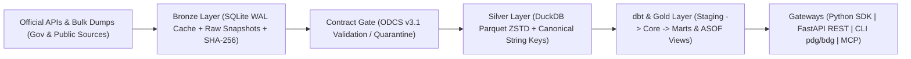

# Public Data Gateway — Medallion Lakehouse, dbt Models & API Gateway (Python, DuckDB, dbt, FastAPI, MCP)

> **Context & Architecture:**  
> Open-source Medallion data platform (`Bronze` ➔ `Silver` ➔ `Gold` + `dbt` marts) and multi-interface gateway (**Python SDK**, **FastAPI REST**, **CLI**, and **MCP Server**) built with **Python 3.12**, **DuckDB**, **Apache Parquet (`ZSTD`)**, **SQLite (`WAL`)**, and **dbt-duckdb** over official Brazilian government datasets and complementary public/global APIs.  
> *Note on documentation:* Source registries ([`CATALOG.md`](CATALOG.md)), ADRs ([`docs/adr/`](docs/adr/)), implementation logs ([`JORNADA_IMPLEMENTACAO.md`](JORNADA_IMPLEMENTACAO.md)), and dataset column descriptions are maintained in Portuguese to align with official Brazilian public-sector schemas.

---

## 1. Architecture & Data Flow (`Bronze` ➔ `Silver` ➔ `Gold` & Delivery)



### Layer Breakdown
1. **Hybrid Ingestion & Storage (`src/public_data_gateway/core/storage.py` — [ADR-001](docs/adr/ADR-001-medallion-hybrid-storage.md)):**
   - **Bronze:** Local SQLite (`WAL` mode with TTL & `Stale-While-Error` fallback) for low-latency REST endpoints, plus raw snapshots sealed with `SHA-256` manifests.
   - **Silver:** Embedded **DuckDB** materialized as `ZSTD`-compressed Apache Parquet via atomic swaps, eliminating cloud warehouse infrastructure costs for local analytics.
2. **Data Contracts, Canonical Keys & Quarantine (`ODCS v3.1` — [ADR-002](docs/adr/ADR-002-canonical-keys-odcs-quarantine.md), [ADR-004](docs/adr/ADR-004-connector-medallion-parity-policy.md)):**
   - Declarative `contract.yaml` policies per connector enforcing freshness, volume, schema, null thresholds, and sentinel-to-`NULL` normalization (`99`, `999`, `-1`, `"SEM INFORMACAO"`).
   - Preserves relational keys as explicit `STRING` identifiers (`id_municipio` 7D/6D crosswalks, `cnpj_14`, `cep_8`, `cnae_7`, `cbo_6`, `ncm_8`, `cpf_masked`) so leading zeros are never stripped; failed batches are routed to `quarantine/` without corrupting clean `Silver` partitions.
3. **Analytics Engineering & Cross-Domain Marts (`dbt/` + DuckDB):**
   - Modular dbt pipeline structured in `Staging` (`source.yml` + normalization) ➔ `Core` (`dim_*`, `fct_*`) ➔ domain and cross-domain `Gold` marts (`feature_store_cross_domain_municipio`) with point-in-time `ASOF JOIN` support.
   - Governed by automated schema assertions and `scripts/lint_dbt_docs.py` enforcing 100% model and column documentation coverage.
4. **Enrichment, DevSecOps & Cloud Mirror (`src/public_data_gateway/` — [ADR-003](docs/adr/ADR-003-devsecops-lgpd-isolation.md)):**
   - **Enrichment (`enrichment/engine.py`):** Offline Mod-11 check-digit validation (`CNPJ`, `CPF`, `IBGE`), municipality/UF disambiguation, **Client Path Shield** (external outputs cannot write inside internal `data/` storage), zip-bomb expansion limits (`<= 100:1`), CSV formula-injection sanitization (`CWE-1236`), masked CPF preservation (`LGPD`), and `<untrusted_gov_data>` prompt-injection delimiters on MCP responses (`OWASP LLM01`).
   - **Open-Core Lakehouse Adapters (`lakehouse/`):** Freshness SLA auditing, `SHA-256`/row-count CDC delta planning, S3/R2/local mirror adapters, and read-only DuckDB/MotherDuck/BigQuery warehouse DDL generators.

---

## 2. Running Locally & Verification

### Prerequisites
- Python `3.12+` with pinned dependencies in [`requirements.txt`](requirements.txt) and [`requirements-dev.txt`](requirements-dev.txt).

```bash
python -m venv .venv
source .venv/bin/activate  # Windows: .\.venv\Scripts\Activate.ps1
pip install -r requirements.txt -r requirements-dev.txt
pip install --no-deps -e .

# Lint, catalog/progress sync, dbt metadata coverage & offline test suite
ruff check .
python scripts/render_catalog.py --check
python scripts/render_progress.py --check
python scripts/lint_dbt_docs.py
pytest -m "not live"
```

### Quick Usage (`CLI`, `Python SDK`, `FastAPI`, `MCP`)

```bash
# CLI inspection (supports pdg or bdg)
pdg status
pdg catalog --wave 1
pdg dict ibge_localidades

# REST API (OpenAPI docs at /docs)
uvicorn public_data_gateway.api.app:create_app --factory --reload

# Stdio MCP Server
pdg-mcp
```

```python
from public_data_gateway import PublicData

gw = PublicData()
print(gw.resolve_municipality("Manaus", uf="AM"))
```

---

## 3. Repository Map

| Path | Purpose |
| :--- | :--- |
| [`src/public_data_gateway/connectors/`](src/public_data_gateway/connectors/) | Domain connectors, `contract.yaml` policies, and per-source dbt staging models |
| [`src/public_data_gateway/enrichment/`](src/public_data_gateway/enrichment/) | Offline check-digit validator, municipality normalizer, and guarded enrichment engine |
| [`src/public_data_gateway/lakehouse/`](src/public_data_gateway/lakehouse/) | CDC delta tracker, freshness SLA auditor, mirror, and warehouse adapters |
| [`src/public_data_gateway/api/`](src/public_data_gateway/api/), [`cli/`](src/public_data_gateway/cli/), [`mcp/`](src/public_data_gateway/mcp/), [`sdk.py`](src/public_data_gateway/sdk.py) | Unified FastAPI, CLI (`pdg`/`bdg`), MCP stdio, and Python SDK interfaces |
| [`dbt/`](dbt/) | DuckDB dbt configuration, `core`/`marts` SQL models, and automated tests |
| [`catalog/`](catalog/) & [`docs/adr/`](docs/adr/) | YAML source registries and Architecture Decision Records (`ADR-001`–`ADR-004`) |
| [`tests/`](tests/) | Offline deterministic suite (`pytest -m "not live"`) and live endpoint smoke tests (`@pytest.mark.live`) |
